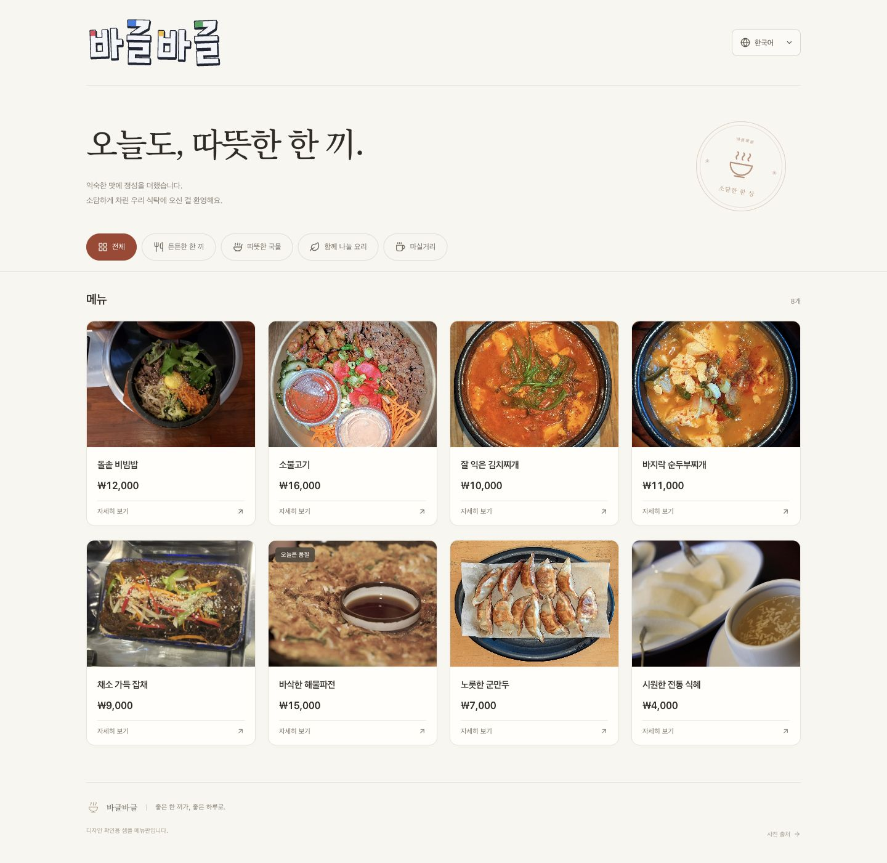
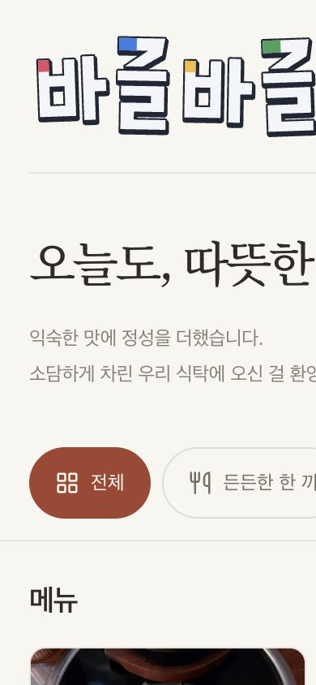

# QR MENU · 바글바글

테이블에서 QR을 찍어 사진과 함께 메뉴를 읽는 모바일 중심 웹 메뉴판입니다. 한국어·영어·중국어 간체·중국어 번체를 지원합니다.

현재는 **목업 데이터로 디자인과 탐색 흐름을 확인하는 손님용 프론트엔드**입니다. 로그인 없이 실행할 수 있고, Supabase 프로젝트나 환경 변수 없이도 동작합니다.

## 구현한 기능

- 사진·메뉴명·가격을 보여주는 메뉴 카드 8개
- 전체 / 한 끼 / 국물 / 나눔 요리 / 마실거리 카테고리 탐색
- 사진·설명·원산지·알레르기 정보를 보여주는 상세 모달
- 품절 메뉴 표시와 품절 메뉴의 상세 조회
- 네 언어 선택, URL·기기 저장값·브라우저 언어에 따른 초기 언어 설정
- 모바일 2열, 좁은 화면 1열, 태블릿 3열, PC 4열 반응형 배치
- 모달 내부 스크롤, 배경 스크롤 잠금, 키보드 초점 관리
- 뒤로가기·닫기·Escape로 상세 닫기, 목록 위치와 초점 복원
- 로딩·빈 목록·조회 실패·재시도·이미지 실패 상태

메뉴·사진·가격·번역·원산지·알레르기 정보는 모두 디자인 확인용 샘플입니다. 실제 매장의 정보나 검수한 식품 정보를 뜻하지 않습니다. 주문·장바구니·결제·ASK·분석 도구·관리자 화면·실제 API 연결은 이 프론트 초안에 포함하지 않습니다.

상호는 **바글바글**이며, 헤더 로고는 매장 간판의 굵은 글씨와 네 가지 색상 포인트를 참고해 SVG 경로로 제작했습니다. 별도 폰트 다운로드 없이 기기마다 동일하게 표시됩니다. 로고는 `src/components/BrandWordmark.tsx`에서 수정합니다.

## 화면



<details>
<summary>모바일 메뉴판 보기</summary>



</details>

## 시작하기

Node.js 22.12 이상과 npm을 사용합니다.

```bash
git clone https://github.com/kohyunseok518/QR-MENU.git
cd QR-MENU
npm ci
npm run dev
```

터미널에 출력된 Local 주소에서 메뉴판을 확인합니다. 기본 주소는 `http://localhost:5173/menu`입니다. 같은 네트워크의 휴대폰에서는 터미널의 Network 주소에 `/menu`를 붙여 접속할 수 있습니다.

| 명령              | 동작                            |
| ----------------- | ------------------------------- |
| `npm run dev`     | 개발 서버와 HMR                 |
| `npm test`        | 언어 선택·데이터 경계 테스트    |
| `npm run build`   | TypeScript 검사와 프로덕션 빌드 |
| `npm run preview` | 빌드한 `dist/` 확인             |

의존성은 `package-lock.json`으로 고정합니다. 파일 수정이 개발 화면에 반영되지 않는 환경에서는 `CHOKIDAR_USEPOLLING=true npm run dev`로 변경 감지를 켤 수 있습니다. 개발 서버의 포트가 사용 중이면 Vite가 출력하는 실제 주소를 확인하세요.

## 언어 동작

| 표기     | 코드      | 직접 열기            |
| -------- | --------- | -------------------- |
| 한국어   | `ko`      | `/menu?lang=ko`      |
| English  | `en`      | `/menu?lang=en`      |
| 简体中文 | `zh-Hans` | `/menu?lang=zh-Hans` |
| 繁體中文 | `zh-Hant` | `/menu?lang=zh-Hant` |

선택 순서는 **유효한 URL 언어 → 기기에 저장된 언어 → 브라우저 선호 언어 → 한국어**입니다. `zh-TW`·`zh-HK`·`zh-MO`는 번체, `zh-CN`·`zh-SG`·`zh`는 간체로 연결하며 명시된 `Hans`·`Hant` 스크립트가 지역보다 우선합니다.

언어 선택은 메뉴·상세·공통 문구·문서의 `lang` 속성·제목·URL에 함께 적용됩니다. 저장소를 사용할 수 없는 환경에서도 현재 화면의 언어 전환은 동작합니다. 언어를 바꿔도 가격은 동일한 KRW 금액입니다.

## 구조와 데이터 흐름

```text
src/
├── components/     메뉴 카드, 사진, 상세 모달, 언어 선택
├── data/
│   ├── fixtures.ts          DB 컬럼 형태의 목업 행
│   ├── mapper.ts            DB 행 → 화면용 모델
│   └── menuRepository.ts    조회 구현과 교체 지점
├── domain/menu.ts  데이터 모델과 MenuRepository 계약
├── hooks/          조회 상태, 언어, 모달 history
├── i18n/           네 언어 공통 문구와 코드 번역
├── App.tsx         손님 메뉴판 화면
└── styles.css      반응형 스타일

public/
├── images/         최적화한 샘플 음식 사진
├── photo-credits.html
└── photo-credits.json
```

```text
MenuRepository.getCatalog(signal)
  → DB 형태의 categories / menu_items
  → mapCatalog()
  → MenuCatalog
  → useMenuCatalog()
  → 카드와 상세 모달
```

컴포넌트는 목업 파일이나 Supabase SDK에 직접 접근하지 않습니다. 목업도 비동기 조회와 `AbortSignal`을 지원하고, 매번 독립된 데이터 사본을 반환합니다. 탭이 다시 활성화되면 데이터를 재조회합니다.

`mapCatalog()`는 숨김 메뉴와 공개 메뉴가 없는 카테고리를 제외하고, 카테고리·메뉴 순서를 적용합니다. 품절 메뉴는 유지합니다. 카테고리 누락·잘못된 가격·필수 번역 누락은 빈 메뉴나 조용한 번역 대체로 처리하지 않고 조회 실패로 전달합니다. **클라이언트의 숨김 제외 처리는 서버 RLS를 대체하지 않습니다.**

## Supabase API 연결 지점

교체 지점은 `src/data/menuRepository.ts`의 `menuRepository`입니다.

1. `MenuRepository`를 구현하는 Supabase 조회 계층을 만듭니다.
2. `categories`, `menu_items`를 조회하고 `CategoryRow[]`, `MenuItemRow[]` 형태로 받습니다. 두 쿼리의 오류를 확인하고 전달받은 `AbortSignal`도 연결합니다.
3. 결과를 `mapCatalog(categoryRows, menuRows, resolveImage)`에 전달합니다.
4. `resolveImage`에서는 DB의 `image_path`를 Storage 공개 URL로 변환합니다. 사진 경로가 없으면 `null`을 유지합니다.
5. `menuRepository`에 새 구현을 연결합니다. UI 컴포넌트의 데이터 접근 코드는 변경하지 않습니다.

현재 타입은 DB의 `name_ko`, `name_en`, `name_zh_hans`, `name_zh_hant`, 언어별 설명, 단일 정수 가격, 원산지 코드 목록, 알레르기 코드와 검수 상태를 반영합니다. `src/i18n/copy.ts`에는 초기 DB 마이그레이션의 재료·알레르기 코드 번역이 있습니다. 국가명은 `Intl.DisplayNames`로 표시합니다.

실제 연결에는 브라우저용 publishable key와 공개 조회 RLS를 사용합니다. service role·secret key·DB 비밀번호는 브라우저 코드나 `VITE_` 환경 변수에 넣지 않습니다. 이 저장소는 Supabase 자격 증명을 포함하지 않고 DB를 수정하지 않습니다.

## 목업 수정하기

- 상호와 공통 문구: `src/i18n/copy.ts`
- 메뉴·가격·카테고리·품절 상태·번역: `src/data/fixtures.ts`
- 사진: `public/images/`와 각 행의 `image_path`
- 색상·서체·여백: `src/styles.css`

`available`은 판매 중, `sold_out`은 품절, `hidden`은 비공개입니다. `allergen_review_status: 'unreviewed'`와 빈 알레르기 목록은 서로 다른 의미입니다. 미확인 정보를 '없음'으로 바꾸거나 식단 적합성을 자동 판단하지 않습니다.

## Vercel 빌드 설정

- Framework: Vite
- Install: `npm ci`
- Build: `npm run build`
- Output: `dist`

`vercel.json`이 `/menu` 직접 접속을 `index.html`로 연결합니다. 사진과 출처 페이지는 정적 파일로 제공됩니다. 이 README의 배포 설정은 저장소 설정 방법이며 실제 Vercel 배포 완료를 의미하지 않습니다.

## 검증

검증 환경은 Node.js 26.3.1과 Chromium 기반 브라우저입니다. 320·390·768·1440px × 네 언어의 16개 조합에서 가로 넘침 없이 표시되는 것을 확인했습니다. 실제 iPhone Safari·Android 실기기 검증과 실제 API 연동 테스트는 수행하지 않았습니다.

`npm test`는 URL·저장값·브라우저 언어 우선순위, 중국어 스크립트 구분, 가격 표시, 숨김·품절 처리, 이미지 경로 변환, 잘못된 데이터 거부, 요청 취소와 독립된 목업 사본을 검증합니다.

브라우저 검증은 반응형 레이아웃·이미지 로딩·카테고리 전환·네 언어·모달 닫기와 뒤로가기·선택 언어 유지·초점 복원을 대상으로 합니다. 테스트 코드와 목업은 실제 Supabase·Storage·Auth에 연결하지 않습니다.

## 사진 출처

샘플 음식 사진은 Wikimedia Commons에서 가져와 크기를 줄이고 JPEG로 압축했습니다. 화면에서는 비율에 맞춰 잘라 표시합니다. 사진별 저작자·원본·라이선스·변경 사항은 [사진 출처 정리](docs/PHOTO_CREDITS.md)와 [출처 데이터](public/photo-credits.json)에 기록되어 있으며, 메뉴판 하단에서도 열 수 있습니다. 각 사진의 원래 라이선스가 적용됩니다.
